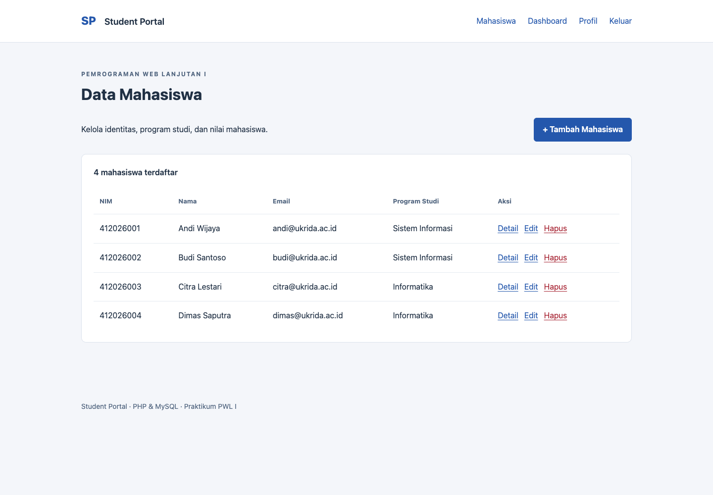

# Student Portal — CRUD Mahasiswa

Project praktikum **Pemrograman Web Lanjutan I, Sistem Informasi UKRIDA**. Repository akun `dismasekacahya` ini melanjutkan Student Portal pertemuan 7 dengan CRUD prosedural sesuai materi Create/Read dan Update/Delete.



## Asal dan cakupan

Basis project adalah `pertemuan7.zip` dari bahan perkuliahan yang disediakan. Fungsi bobot nilai (30% tugas, 30% UTS, 40% UAS), grade, kelulusan, predikat, dan remedial dipertahankan. Kelanjutan meliputi daftar dengan JOIN program studi, tambah, edit, konfirmasi hapus, database SQL, validasi, serta dokumentasi. Implementasi dan verifikasi kelanjutan dibantu AI; ini bukan klaim bahwa seluruh source telah selesai dibuat pada pertemuan sebelumnya. Mahasiswa tetap perlu memahami dan menjelaskan kode yang dikumpulkan.

Bahan ajar PDF dan tangkapan layar Moodle tidak dipublikasikan ulang. Lihat [catatan pengembangan](docs/KONTEKS.md).

## Fitur

- Login/logout berbasis session, dashboard dan profil mahasiswa.
- Create, Read, Update, Delete data mahasiswa dan nilai akademik.
- Relasi `mahasiswa.id_prodi` → `program_studi.id_prodi` melalui foreign key.
- Prepared statement, escaping HTML, hash password, validasi server, token CSRF.
- POST/Redirect/GET dan pesan hasil; hapus memerlukan konfirmasi POST.
- Penanganan ID tidak valid, data tidak ditemukan, dan NIM/email duplikat.

## Menjalankan dengan XAMPP / Laragon

1. Aktifkan Apache dan MySQL/MariaDB. Gunakan PHP **8.1 atau lebih baru** dengan `mysqli`/mysqlnd dan `mbstring`.
2. Clone/download repository ke `htdocs/student-portal` (XAMPP) atau `www/student-portal` (Laragon).
3. Buka phpMyAdmin, pilih **Import**, lalu impor `database/student_portal.sql`. Script membuat database `student_portal` dan tabel beserta empat data fiktif. Gunakan database baru; script tidak menghapus tabel lama. Jangan mengimpor ulang pada database berisi tabel yang sama.
4. Default koneksi: `127.0.0.1`, port `3306`, user `root`, password kosong. Bila berbeda, salin `config.local.example.php` menjadi `config.local.php`, lalu sesuaikan. File lokal tersebut diabaikan Git.
5. Buka `http://localhost/student-portal/login.php`.
6. Login demo: **andi@ukrida.ac.id** / **123456**. Akun demo lain: `budi@ukrida.ac.id`, `citra@ukrida.ac.id`, `dimas@ukrida.ac.id`, dengan password yang sama.

Alternatif PHP CLI setelah import database:

```sh
php -S 127.0.0.1:8080
```

Buka `http://127.0.0.1:8080`. Jalankan perintah dari root repository. Konfigurasi juga dapat melalui `DB_HOST`, `DB_PORT`, `DB_USER`, `DB_PASSWORD`, `DB_NAME`.

## Alur mencoba CRUD

1. Masuk, lalu pilih **Mahasiswa**.
2. **Tambah Mahasiswa**: isi NIM unik, identitas, prodi, nilai 0–100, kehadiran bulat 0–100, dan password minimal 6 byte.
3. **Detail**: periksa data dan perhitungan nilai akhir.
4. **Edit**: perbarui identitas/nilai. Password kosong mempertahankan password lama.
5. **Hapus**: pastikan identitas benar, pilih **Ya, Hapus**. Akun yang sedang login tidak dapat menghapus dirinya sendiri.
6. **Keluar**: konfirmasi untuk mengakhiri session.

## Struktur file

```text
assets/style.css              Tampilan responsif tanpa dependensi CDN
config.php                    Koneksi mysqli
config.local.example.php      Contoh konfigurasi lokal
functions.php                 Perhitungan, query, session, validasi request
index.php / mahasiswa.php     Daftar / tautan kompatibilitas project lama
tambah.php / edit.php          Halaman create dan update
hapus.php / detail.php         Konfirmasi delete dan read satu record
login.php / logout.php         Autentikasi session
dashboard.php / profile.php    Evaluasi dan profil akun yang login
includes/                     Template dan form bersama
database/student_portal.sql   Skema dan data fiktif praktikum
data.php                      Referensi array pertemuan 7, bukan sumber data aktif
tests/http_smoke.py            Uji integrasi HTTP
docs/                         Konteks dan panduan penjelasan kode
```

## Verifikasi

Uji integrasi membutuhkan **database pengujian** yang telah diimpor dan server berjalan. Pengujian membuat, mengubah, dan menghapus satu mahasiswa fiktif.

```sh
python3 tests/http_smoke.py http://127.0.0.1:8080
```

Hasil verifikasi aktual tersedia di [docs/VERIFIKASI.md](docs/VERIFIKASI.md).

## Batas aplikasi praktikum

Setiap akun yang login dapat mengelola data mahasiswa; tidak ada pemisahan peran admin/mahasiswa dalam materi CRUD ini. Data demo sepenuhnya fiktif. Gunakan secara lokal untuk pemeriksaan praktikum; penggunaan dengan data nyata memerlukan kontrol akses berbasis peran dan pengamanan deployment tambahan. GitHub menyimpan source PHP, bukan menjalankan server PHP/MySQL.

## Pengumpulan UVC

Kumpulkan **link repository publik** dan **screenshot halaman repository** yang menunjukkan username, nama repository, serta daftar source. Unggah melalui Assignment UVC secara manual. Panduan pemahaman kode: [docs/PANDUAN_KODE.md](docs/PANDUAN_KODE.md).
